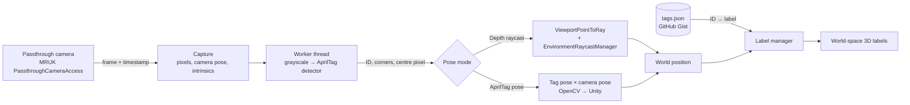

# Quest 3 AprilTag Passthrough

**Detect AprilTags with the Meta Quest 3 passthrough camera and pin floating 3D labels on real-world objects, in Unity.**

Labels come from an online JSON database, so you can add a new tag (for example `ID 3 → "Box no 3"`) by editing one file, with **no code change and no rebuild**.


## Table of contents

1. [Features](#features)
2. [How it works](#how-it-works)
3. [Requirements](#requirements)
4. [Quick start: just try the APK](#quick-start-just-try-the-apk)
5. [Build from source](#build-from-source)
6. [Set up your own tag database](#set-up-your-own-tag-database)
7. [Print the AprilTags](#print-the-apriltags)
8. [Controls](#controls)
9. [Project structure](#project-structure)
10. [Technical details](#technical-details)
11. [Troubleshooting](#troubleshooting)
12. [Known limitations and roadmap](#known-limitations-and-roadmap)
13. [Credits and licenses](#credits-and-licenses)
14. [Contributing](#contributing)

---

## Features

| Level | What it does |
|---|---|
| **1. Live camera feed** | Full passthrough (you see your real room) plus a floating panel that shows the headset's front camera feed. |
| **2. Capture and detect** | Press **A** to capture a frame. AprilTags (`tag36h11`) in it are detected and their IDs are shown next to the captured image. |
| **3. Database lookup** | Each ID is mapped to a label (e.g. `1 → "Box no 1"`) from a **JSON database**. Nothing is hard-coded. |
| **4. 3D labels on real tags** | Labels float ~5 cm above each real tag and stay locked in place while you walk around. Works with several tags at once. New tags need only a database edit. |
| **Bonus: continuous mode (beta)** | Press **B** to detect tags continuously, about 5 times per second, without pressing a button. |

Extras:
- Online database with local cache and an offline fallback, plus in-app **Reload** (X button).
- Two positioning modes: **Depth raycast** (default, uses the headset's depth sensor) and **AprilTag pose** (pure computer vision).
- Labels disappear when a tag is covered or removed.
- A debug view shows the tag axes and green/red reprojection corners.

---

## How it works



1. **Camera:** `PassthroughCameraAccess` (from Meta's Mixed Reality Utility Kit) gives the camera texture, the camera's world pose at the frame timestamp, and the calibrated intrinsics.
2. **Capture:** the frame's pixels are copied together with the pose and intrinsics *at capture time*, so the head can move while detection runs.
3. **Detection:** a native AprilTag library (C, via P/Invoke) runs on a background thread so the frame rate stays smooth.
4. **Positioning:**
   - **Depth raycast (default):** a ray through the tag-centre pixel is cast against the environment depth, and the hit point is the tag's world position.
   - **AprilTag pose:** the tag's 3D pose comes from its 4 corners, the camera intrinsics and the physical tag size, then gets transformed to world space.
5. **Database:** `tags.json` is downloaded from a URL, cached on the device, and used to turn IDs into labels.
6. **Labels:** one world-space label per tag ID. It always faces you, is smoothed when re-detected, and is removed if the tag is in view but no longer detected.

---

## Requirements

| | Version |
|---|---|
| Headset | **Meta Quest 3 or 3S** (the passthrough camera API is not available on Quest 2 / Pro) |
| Headset OS | Horizon OS **v74 or newer** |
| Unity | **6000.0.66f2** with **Android Build Support** (OpenJDK, Android SDK & NDK) |
| Meta packages | Meta XR SDK and **MR Utility Kit (MRUK) 85.0.0** (already in `Packages/manifest.json`) |
| Render pipeline | Built-in |
| Other | USB-C **data** cable, Developer Mode enabled on the headset |

> ⚠️ The passthrough camera **does not work in the Unity Editor, over Link, or in the XR Simulator**. Always test on the headset.

---

## Quick start: just try the APK

1. Download `BoxTagApp_Final.apk` from **[Releases](../../releases)**.
2. Enable **Developer Mode** on your Quest (Meta Horizon phone app → Devices → your headset → Developer Mode).
3. Connect the headset over USB. Put it on and accept **"Allow USB debugging"**, ticking **"Always allow from this computer"**.
4. Install:
   ```bash
   adb install -r BoxTagApp_Final.apk
   ```
5. In the headset, open **Library → Unknown Sources → BoxTag App**.
6. Allow the **camera** and **spatial data** permissions when asked.
7. [Print some tags](#print-the-apriltags), look at one, and press **A**.

---

## Build from source

### 1. Clone and open

```bash
git clone https://github.com/rohit892004/quest3-apriltag-passthrough.git
```

- In **Unity Hub**, choose **Add** and select the folder, then open it with **Unity 6000.0.66f2**. Hub offers to install that version if it's missing; tick **Android Build Support + OpenJDK + Android SDK & NDK**.
- The first import takes a while.

### 2. Configure

1. Set the database URL. Open `Assets/BoxTagApp/Data/BoxTagDatabaseSettings.asset` and paste your raw JSON link into **Remote Url** (see [Set up your own tag database](#set-up-your-own-tag-database)).
2. Set the tag size. Select the **BoxTagDetector** object in the scene and set **Tag Size Meters** to the edge of the **outer black square** of your printed tag (e.g. `0.10` for 10 cm). This matters only in AprilTag-pose mode.
3. Open the scene `Assets/BoxTagApp/Scene/BoxTagApp.unity`.

### 3. Build

**From the Editor:**
- **File → Build Profiles → Android → Switch Platform**.
- Make sure only **BoxTagApp** is ticked in the scene list.
- Connect the Quest and click **Build And Run**.

**From the command line (Windows):**
```bat
"<UnityInstall>\6000.0.66f2\Editor\Unity.exe" -batchmode -nographics -quit ^
  -projectPath "<path-to-repo>" ^
  -executeMethod BoxTagAppBuild.BuildApkHeadless ^
  -logFile build.log
```
The APK is written to `Builds/`. Close the Unity Editor first, because a batch build can't open a project the Editor has open.

> ℹ️ Don't run **Tools → BoxTagApp → Setup Scene** on an existing scene. It regenerates the scene and overwrites manual edits. Use it only to rebuild the scene from scratch.

---

## Set up your own tag database

The app reads a JSON file from any public URL. The easiest host is a **GitHub Gist**.

1. Go to <https://gist.github.com>, name the file `tags.json`, and paste:
   ```json
   { "tags": [
     { "id": 1, "family": "tag36h11", "label": "Box no 1" },
     { "id": 2, "family": "tag36h11", "label": "Box no 2" }
   ] }
   ```
2. Click **Create secret gist** (or public), then **Raw**.
3. Copy the URL and **remove the commit hash** after `/raw/` so it always serves the latest version:
   ```
   https://gist.githubusercontent.com/<user>/<gist-id>/raw/tags.json
   ```
4. Paste it into **Remote Url** (see above) and build once.

**Adding a new tag later (no rebuild):**
1. Edit the Gist and add `{ "id": 3, "family": "tag36h11", "label": "Box no 3" },`.
2. Wait 1–2 minutes, because GitHub caches raw files briefly.
3. In the headset press **X** (Reload DB). The status shows `DB reloaded: N tags`.
4. Look at tag 3 and press **A**. You'll see **"Box no 3"**.

**Database status on the panel:**

| Status | Meaning |
|---|---|
| `DB: online, N tags` | Downloaded from the URL just now |
| `DB: cached, N tags` | Offline, using the last successful download |
| `DB: offline default, N tags` | No URL or cache, using the bundled `Resources/BoxTagDefaultTags.json` |

JSON rules: every entry except the last ends with a comma, and text goes in double quotes. Check it at [jsonlint.com](https://jsonlint.com) if the app shows the wrong status.

---

## Print the AprilTags

1. Download **tag36h11** images from [AprilRobotics/apriltag-imgs](https://github.com/AprilRobotics/apriltag-imgs/tree/master/tag36h11), e.g. `tag36_11_00001.png`.
2. The images are tiny (10×10 px). Scale them up with **nearest-neighbour** (no smoothing) so the edges stay sharp.
3. Print so that the **outer black square is exactly 10 cm**, and keep a white margin around it.
4. **Measure with a ruler** and put the value in **Tag Size Meters**.
5. Use good lighting. Dark rooms make detection unreliable.

You can also show a tag full-screen on a phone or monitor at full brightness.

---

## Controls

| Button | Action |
|---|---|
| **A** / right trigger | Capture a frame and detect tags |
| **B** | Toggle continuous detection (beta) |
| **X** (left) | Reload the tag database |
| **Y** (left) | Toggle debug view (tag axes + reprojection corners) |
| **Left thumbstick click** | Switch pose mode: Depth raycast ↔ AprilTag pose |
| **Right grip (tap)** | Move the panels in front of you |
| **Right grip (hold 1 s)** | Clear all labels |

---

## Project structure

```
Assets/
├── BoxTagApp/                  ← this project's code
│   ├── Scripts/
│   │   ├── BoxTagCameraFeed.cs     Level 1: shows the camera texture on the feed panel
│   │   ├── BoxTagCapture.cs        Level 2: capture input, frame + pose + intrinsics, continuous mode
│   │   ├── BoxTagDetector.cs       AprilTag detection on a worker thread
│   │   ├── BoxTagPoseMath.cs       Intrinsics crop/scale, OpenCV → Unity conversion, reprojection
│   │   ├── BoxTagDatabase.cs       Level 3: download, cache and fallback for tags.json
│   │   ├── BoxTagLabels.cs         Level 4: world-space labels, smoothing, removal
│   │   └── BoxTagLayout.cs         UI panels (sizes and distances in one place)
│   ├── Editor/
│   │   ├── BoxTagAppSetup.cs       Tools > BoxTagApp > Setup Scene
│   │   └── BoxTagAppBuild.cs       Headless APK build
│   ├── Data/BoxTagDatabaseSettings.asset   Remote URL setting
│   ├── Resources/                  Default tags.json, debug materials
│   └── Scene/BoxTagApp.unity
├── AprilTag/                   ← third-party AprilTag library (BSD-2), see Credits
└── PassthroughCameraApiSamples/  ← Meta sample project (base)
```

> File names reflect the current version. Check the folder if something has moved.

---

## Technical details

<details>
<summary><b>Camera intrinsics: crop and scale</b></summary>

`PassthroughCameraAccess.Intrinsics` is given for the full sensor (1728×1728). The 1280×960 image is a **centred 4:3 crop** of the sensor (1728×1296, `cropY = 216`) followed by a **uniform** scale `s = 1280 / 1728`:

```
fx' = fx · s
fy' = fy · s
cx' = (cx − cropX) · s
cy' = H − (cy − cropY) · s     // MRUK's principal point uses a bottom-left origin
```

Scaling x and y differently (e.g. 1280/1728 and 960/1728) gives `fx ≠ fy` and wrong poses.
</details>

<details>
<summary><b>AprilTag pose → world</b></summary>

The detector returns the tag pose in camera space. `BoxTagPoseMath` converts it to Unity's camera space **once** (OpenCV is x-right, y-down, z-forward; Unity is left-handed, y-up). It's then multiplied by the camera's world pose at the **capture timestamp**:

```
tagWorld = cameraPoseAtCapture × tagInCamera
```

Accuracy depends on **Tag Size Meters** matching the printed tag. The debug view draws detected corners (green) and corners reprojected from the computed pose (red). They should overlap (≈1 px error).
</details>

<details>
<summary><b>Depth raycast (default positioning)</b></summary>

`PassthroughCameraAccess.ViewportPointToRay` builds a ray through the tag-centre pixel using the capture-time pose. MRUK's `EnvironmentRaycastManager` intersects it with the environment depth. The hit is the tag's world position, and the AprilTag pose is only used for orientation. If the raycast fails, it falls back to the AprilTag pose (yellow dot). This needs the **spatial data (USE_SCENE)** permission.
</details>

<details>
<summary><b>Threading and performance</b></summary>

- Single capture reads pixels with `GetColors()`, which blocks once per press.
- Continuous mode uses non-blocking `AsyncGPUReadback`, with one readback and one detection in flight.
- Detection takes ~20–30 ms on a worker thread, and the main-thread copy takes ~1 ms.
</details>

---

## Troubleshooting

| Problem | Fix |
|---|---|
| `adb: device unauthorized` | Put the headset on, accept the USB debugging prompt, and **tick "Always allow"** first. If it keeps asking: Settings → Developer → revoke USB authorizations, toggle USB debugging, reconnect. Use a USB-C **data** cable. |
| Black background, only the panel visible | Passthrough isn't enabled. You need OVRManager → Insight Passthrough on, an `OVRPassthroughLayer` (Underlay), camera clear to solid colour with alpha 0, and no skybox. |
| Pink dots or lines | Shader stripped from the build. Materials must use `Unlit/Color` (Built-in RP) and be included (Resources or Always Included Shaders). |
| "No tags found" | Check lighting, the tag isn't too small (≥ 5 cm at ≤ 1 m), the family is `tag36h11`, and the print is sharp with a white margin. |
| Label in the wrong place | Use Depth raycast mode. In AprilTag mode, check **Tag Size Meters** and the red/green corners in the debug view. |
| Yellow dot | The depth raycast failed. Grant the spatial data permission: `adb shell pm grant com.asas.boxtagapp com.oculus.permission.USE_SCENE` |
| `DB: offline default` | Check the URL, the headset's Wi-Fi, and the JSON syntax. |
| Build error `...aapt_friendly_merged_manifests...AndroidManifest.xml` | Harmless Meta post-build step. The APK is still built. Moving the project to a short path (e.g. `D:\BoxTag`) also helps. |
| Batch build fails / lock file | Close the Unity Editor. Batch builds can't open a project the Editor has open. |
| App doesn't update after install | The package name changed, so you have two apps. Open **BoxTag App** (`com.asas.boxtagapp`) and uninstall the old one. |

**Logs:**
```bash
adb logcat -c
adb logcat | grep "\[BoxTag\]"          # macOS/Linux
adb logcat | Select-String "[BoxTag]"   # PowerShell
```

---

## Known limitations and roadmap

- [ ] `tagStandard52h13` isn't supported yet. It needs the native AprilTag library rebuilt with that family.
- [ ] Continuous mode is **beta**. Single capture (A) is the reliable path.
- [ ] Labels are not saved across sessions. Spatial anchors could be added.
- [ ] Only the left camera is used. Stereo could improve depth.

Pull requests are welcome.

---

## Credits and licenses

- **This project's code** (`Assets/BoxTagApp`): MIT, see [LICENSE](LICENSE).
- **AprilTag C library**: © University of Michigan APRIL Robotics Lab, BSD-2-Clause. Unity wrapper based on [keijiro/jp.keijiro.apriltag](https://github.com/keijiro/jp.keijiro.apriltag). See `Assets/AprilTag/LICENSE`.
- **Meta Passthrough Camera API Samples** ([oculus-samples/Unity-PassthroughCameraApiSamples](https://github.com/oculus-samples/Unity-PassthroughCameraApiSamples)): used as the base project, under Meta's license. See its LICENSE file.
- **Meta XR SDK / MRUK**: © Meta Platforms, under the Meta SDK license.

---

## Contributing

1. Fork the repo and create a branch: `git checkout -b feature/my-change`.
2. Keep new code inside `Assets/BoxTagApp/`.
3. Test on a real Quest 3/3S and include a short note or video in the PR.
4. Open a pull request.

Found a bug? Open an **[issue](../../issues)** with your headset OS version, Unity version, and the `[BoxTag]` log lines.

⭐ If this helped you, please star the repo so others can find it.
